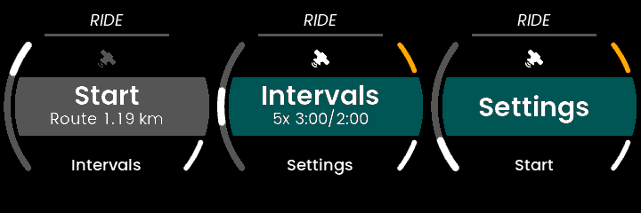
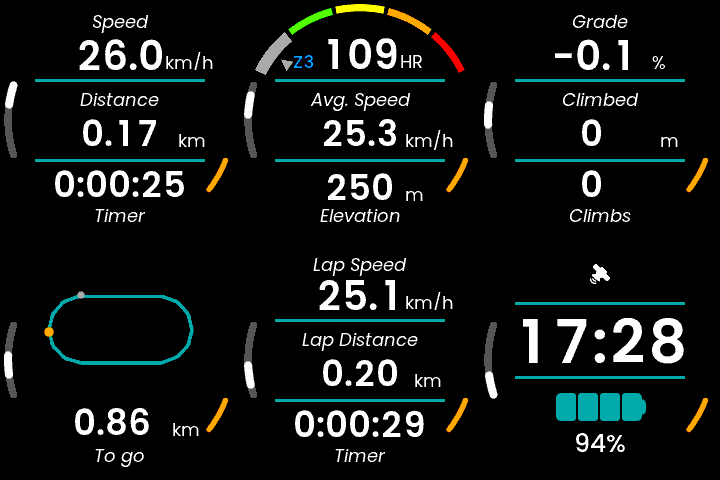
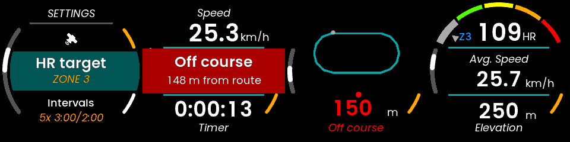
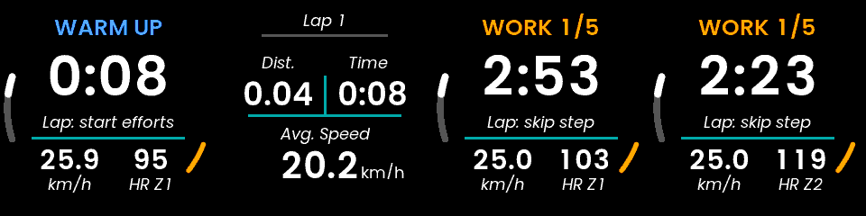
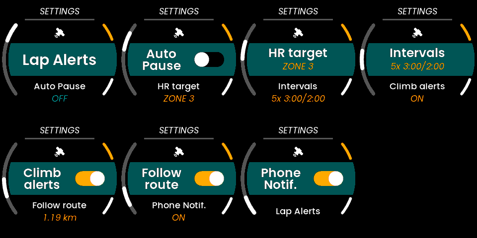

# Ride: a cycling app for the UNA Watch

A cycling app for the [UNA Watch](https://unawatch.com/pages/open-source), built on UNA's open-source Cycling example. On top of what that example does (speed, distance, heart rate, elevation, auto-pause, auto-laps, external HR straps, FIT recording) it adds:

- **Climbs**: detects climbs from the barometer and shows grade, climb gain, distance, average grade and VAM while you are on one. It buzzes when a climb starts and at the summit, with a summary.
- **Route following**: copy a GPX file to the watch and the app shows the route with your position, the distance still to ride, and an alert when you go off course (and when you are back on it).
- **Interval sessions**: five time-based presets with an open warm-up and cool-down, a countdown with beeps, and each step recorded as its own FIT lap.
- **Heart-rate zone coaching**: pick a zone to hold. The watch tells you when you drift above or below it, without nagging on long rides.
- **Better FIT files**: grade on every record; intensity (warm-up/active/rest/cool-down) and lap trigger on every lap, so Strava, intervals.icu, TrainingPeaks and similar tools can tell efforts from recoveries.

**Demo video (60 s):** [`docs/video/Ride_demo.mp4`](docs/video/Ride_demo.mp4): a route with a detour, a climb and the summary, in the simulator.





> **Status:** works in the UNA simulator and passes 64 host unit tests and replays of 15 real rides, but has **not yet been tested on a watch**. See [Testing status](#testing-status).

## Using it

### Faces

Step through the faces with the left buttons (L1/L2) during a ride. The list adapts to the ride:

| Face | Shows | When |
|---|---|---|
| Intervals | Step and effort number, time left, speed, HR and zone | Interval sessions (shown first) |
| Speed | Speed, distance, timer | Always |
| Overview | Heart rate and zone bar, HR target badge, average speed, elevation | Always |
| Climb | Live grade; on a climb: gain, distance, average grade, VAM; otherwise climbs ridden and total climbed | Always |
| Route | Route map with your position, distance to go, off-course warning | When a route is loaded |
| Lap | Lap speed, distance, time | Always |
| Clock | Time, battery, GPS and HR sensor status | Always |

The HR target badge (e.g. `Z3`) on the Overview face is green when you are in the zone, red above it, blue below it.

### Following a route

1. Export a GPX from Strava, Komoot, RideWithGPS, Garmin Connect, etc. Track (`<trkpt>`) and route (`<rtept>`) points are both read; waypoints are ignored. Large files are fine: the route is thinned and simplified as it loads.
2. Connect the watch by USB and wait for the mass-storage drive.
3. Copy the file into the app's folder, **next to `Ride.uapp`**, and name it **`route.gpx`**: `Apps/Ride/route.gpx`.
4. Eject the drive. When the app starts, the main menu shows *Start: Route 42.1 km*.

Off course means more than 50 m from the route for 10 seconds; back on course means within 30 m for 3 seconds. For 90 seconds after rejoining there is no new off-course alert, so a brief wobble off the route buzzes once rather than off, on, off, on; if you are still off when the 90 seconds are up, it alerts then. Leaving the route, rejoining it and reaching the end each buzz, with a banner. Routes that use the same road more than once (laps of a circuit, out-and-backs, figure-eights) are followed in order.

Switch route following off in Settings to ride without it; the file stays where it is.



### Interval sessions

Choose a preset in **Settings → Intervals**, then pick **Intervals** (instead of Start) on the main menu.

| Preset | Efforts |
|---|---|
| 5x 3:00/2:00 | VO2max |
| 4x 8:00/4:00 | Threshold |
| 8x 1:00/1:00 | Short efforts |
| 10x 0:30/0:30 | Very short efforts |
| 3x12:00/5:00 | Sweet spot |

The warm-up is open: press the **lap button (R2)** when you are ready for the first effort. Efforts and rests then run on time, with a beep each second for the last five. During an effort or rest, the lap button skips to the next step. After the last effort comes an open cool-down; press lap to end it. Every step is a lap in the FIT file, tagged with its intensity.



### Settings



| Setting | What it does |
|---|---|
| Lap Alerts | Auto-lap by distance or time (unchanged from UNA's example) |
| Auto Pause | Pause when you stop, resume when you ride off (unchanged) |
| HR target | Off, or zone 1–5 of the watch's heart-rate zones. Press to cycle |
| Intervals | The interval preset. Press to cycle |
| Climb alerts | Buzz and banner at the start and summit of each climb |
| Follow route | Use `route.gpx` if there is one. The hint shows its length, `NO FILE` or `BAD FILE` |
| Phone Notif. | Phone notifications while the app runs (unchanged) |

### How the alerts feel

| Event | Haptics / sound |
|---|---|
| Climb starts | Short double click |
| Summit | Two beeps, long double click, backlight |
| Off course | Two beeps, two long buzzes, backlight |
| Back on course | One click |
| Route complete | Three beeps, long buzz, backlight |
| HR above zone | Pulsing buzz (repeats at most every 2 min) |
| HR below zone | Two soft bumps (repeats at most every 2 min) |
| HR back in zone | One click |
| Interval step | Lap alert (three beeps, buzz); countdown beeps before a timed step ends |

## How it works

The cycling logic lives in `Software/Libs/*/Ride/` as plain C++ with no kernel, sensor or GUI dependencies, so it is unit-tested on a PC:

| Class | Job |
|---|---|
| `ClimbDetector` | Grade over a 100 m distance window. A climb opens at 3 %, is confirmed at 15 m of gain, and ends 10 m below the summit or 400 m past it with no new high. It is measured start to summit, and only climbs of 300 m or more are reported. |
| `HrZoneCoach` | The SDK's `HeartRateGauge` (deadband, dwell, hold-off) and `ZoneAlerts`, with same-direction repeats held to 2 minutes. |
| `IntervalSession` | Presets built with the SDK's `buildIntervals()` and run on its workout `Engine`. |
| `GpxReader` | Streaming reader for `trkpt`/`rtept`, fed in chunks of any size. |
| `Route` | Up to 2000 points in local metres, thinned while loading and simplified in place (Douglas–Peucker) when full. A 200 km route fits at a tolerance of a few metres. |
| `RouteFollower` | Windowed matching that groups near-equal segments into passes and keeps progress continuous, plus hysteretic off-course detection and arrival. |

The service (`Service.cpp`) feeds these once per active second and sends the GUI a `RideDataUpd` message, kept separate from `TrackDataUpd` so both fit the kernel's 256-byte message block. Grade comes from the kernel's `GRADE` sensor when the firmware has it, otherwise from the climb detector.

The new screens (`TrackFaceClimb`, `TrackFaceRoute`, `TrackFaceIntervals`, `RideBanner`) are laid out in code rather than TouchGFX Designer, using the project's existing fonts and template texts. Regenerating the Designer project therefore leaves them alone, and no Designer step is needed to build.

## Building

You need the [UNA SDK](https://github.com/UNAWatch/una-sdk) and its toolchain. This repository was developed against SDK commit `d71d0dc` (19 Oct 2026).

```bash
git clone https://github.com/UNAWatch/una-sdk.git
export UNA_SDK=$PWD/una-sdk
python3 -m pip install -r "$UNA_SDK/Utilities/Scripts/app_packer/requirements.txt"
```

### Watch app (`Ride.uapp`)

Use **ST's ARM toolchain** (STM32CubeCLT or STM32CubeIDE) on your `PATH`, as the SDK requires. The distro `gcc-arm-none-eabi` compiles everything but fails to link the service on missing newlib syscall stubs (`_write`, `_read`, `_close`, `_lseek`). The unmodified UNA example fails the same way, so this is not specific to this app.

```bash
cd Software/Apps/Cycling-CMake
cmake -G "Unix Makefiles" -S . -B build
cmake --build build -j
```

Copy the resulting `Ride_<version>.uapp` to `Apps/Ride/` on the watch over USB, eject, and power-cycle the watch ([UNA deploy guide](https://github.com/UNAWatch/una-sdk/blob/main/Docs/deploy.md)).

### Simulator (Linux)

Needs SDL2 (`libsdl2-dev libsdl2-image-dev`) and Ruby with `nokogiri` for the TouchGFX text converter.

```bash
cd Software/Apps/TouchGFX-GUI
make -f simulator/gcc/Makefile -j
cp ../../../docs/simulator-route.gpx ../../../Output/route.gpx   # optional: a route around the simulator's GPS track
cd simulator/gcc && ../../build/bin/simulator.out                 # run from here so files land in Output/
```

Keys `1`–`4` are the buttons L1, L2, R1, R2.

The SDK simulator's barometer is flat, so for climbs set `UNA_SIM_HILL` to a grade in percent (for example `UNA_SIM_HILL=4 ../../build/bin/simulator.out`). After 60 s on the flat, the simulated pressure falls as a road at that grade would for `UNA_SIM_HILL_SEC` seconds (default 240), then rises at the same rate. Only the simulated barometer changes, so the climb faces and alerts come from the app's own detection. `UNA_SIM_SPEED` sets the simulated riding speed in km/h (default 30).

`Tools/sim_tour.sh OUTDIR [--video]` rides a demo route in the simulator (`docs/simulator-route-detour.gpx`: one lap whose second half leaves the track, so you go off course and rejoin), climbs a simulated hill, saves the ride and screenshots every screen on the way. Needs Xvfb, xdotool and ImageMagick (and ffmpeg for `--video`). `Tools/make_video.py OUTDIR` cuts the recording into the demo video.

### Unit tests

They also run on every push (GitHub Actions, `.github/workflows/tests.yml`).

```bash
cmake -S Tests -B Tests/build
cmake --build Tests/build -j
ctest --test-dir Tests/build
```

## Publishing to the community app store

1. Sign up at [apps.unawatch.com](https://apps.unawatch.com), click **Add New**, name the app *Ride* and generate an **App ID**.
2. Put that ID in `APP_ID` in `Software/Apps/Cycling-CMake/CMakeLists.txt`, replacing the local placeholder (`Tools/package.sh` warns while the placeholder is there). Bump `BUILD_VERSION` (now `1.0.0`) for each release.
3. With ST's toolchain on `PATH`, run `UNA_SDK=... Tools/package.sh`. It builds the app and writes `Output/Ride_<version>_store.zip`, containing:
   - the `.uapp`;
   - `app-manifest.json`, with `minKernelVersion` stamped by the SDK's resolver;
   - `icon.png`;
   - the round previews from `docs/store/`.

   `Tools/package.sh --manifest-only` writes just the manifest, to check it.
4. On the app page: **Version → Upload New** → upload the zip → **Release** → **Confirm and Publish**.

Icons are drawn by `Tools/make_icons.py`. Store previews are simulator screenshots, round-masked by `Tools/roundify.py`.

**UNA App Development Competition (October 2026):** publish the app as above, then submit the [Google Form](https://forms.gle/MTWZYWsVgB6UvrxA7) before **30 October 2026, 4 pm UK time**. The app must be new to the store, and each person may enter at most two apps.

## Testing status

- 64 host unit tests cover climb detection, HR zone coaching, interval sessions, GPX parsing, route storage and simplification, and route following (laps, out-and-backs, spurs, detours, fast riders, GPS glitches, no off-course alerts after the route is finished).
- In the simulator: all menus, settings and faces; a 3-lap route followed in order; off-course and HR-target alerts; a full interval warm-up into the first effort; and a simulated 4 % hill, detected as a climb with the start and summit alerts (measured 1.11 km at 3.6 % for a true 1.04 km at 4 %).
- Cross-compiled for the watch's Cortex-M33: the GUI links and packs; the service links once the four syscall stubs above are supplied. Service: 99.6 KB code, 54 KB static RAM (500 KB available).
- Replayed on 15 real rides (33 to 103 km, recorded on a Hammerhead Karoo 2) with their planned GPX routes, using `Tools/replay` (see its README). The rides include loops started part way round, out-and-backs, a loop ridden partly backwards, a lollipop whose stem is ridden both ways, detours of up to 25 km past the end of the route, and a ride that took the planned roads in a different order. Every ride arrived at the finish within metres of where the rider stopped. Every off-course alert matched a real deviation: a café stop, a skipped spur, a parallel street, a detour. Every climb that buzzed a start also buzzed a summit.
- Total ascent comes out 6 to 23 % below the Karoo's on the same altitude data, because the SDK's ascent counter only counts a rise once it reaches 2 m (`mAltitudeCounter.init(2.0f)` in `Service.cpp`). On the Karoo's data a 0.5 m step lands within 0 to 7 %. The Karoo's altitude is already smoothed, though, and the watch's raw barometer may be noisier, so the step stays at 2 m until a ride recorded on the watch shows how much smaller it can safely go.
- **Not yet tested on a watch.** Things worth checking on real rides:
  - climb start and summit timing on the watch's barometer;
  - off-course sensitivity in towns with the watch's GPS;
  - whether the app's folder is `Apps/Ride/`.

## Credits and licence

Based on the Cycling example from [UNAWatch/una-sdk](https://github.com/UNAWatch/una-sdk) (MIT, © UNA Watch Ltd). This project is also MIT; see [LICENSE](LICENSE).
